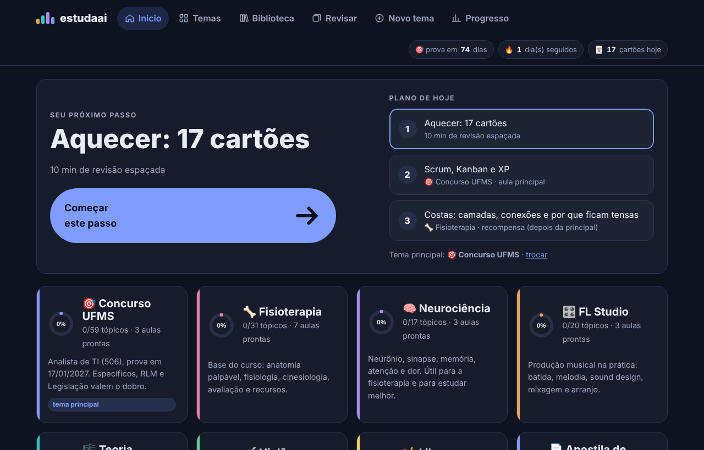
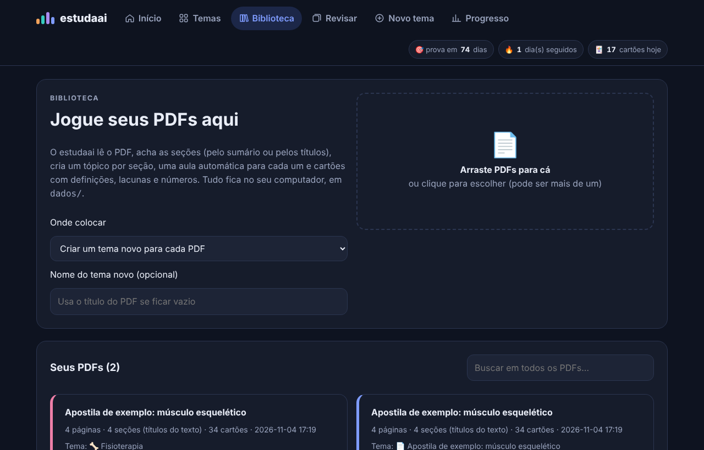
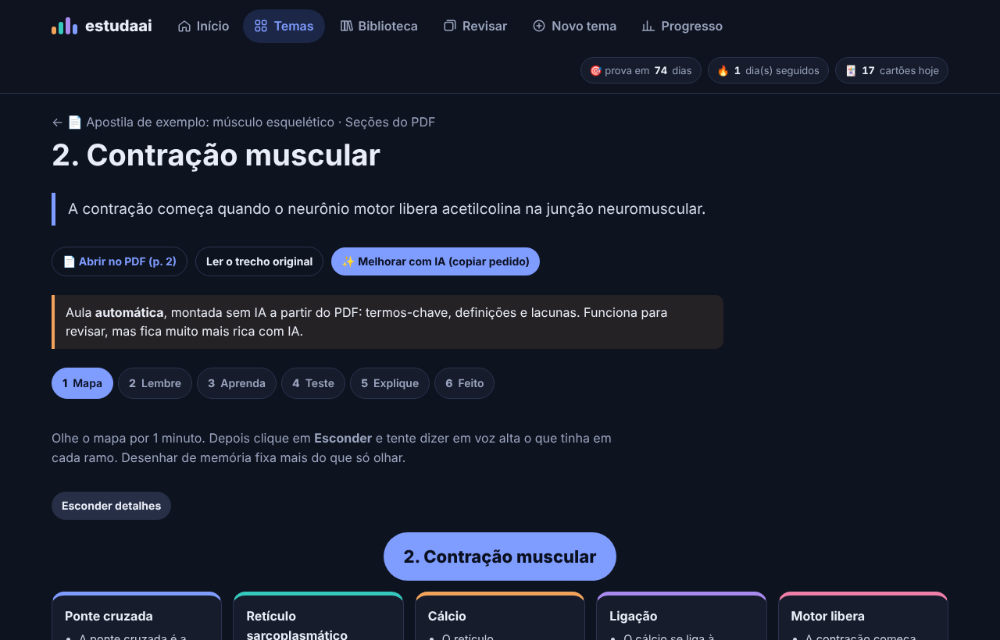
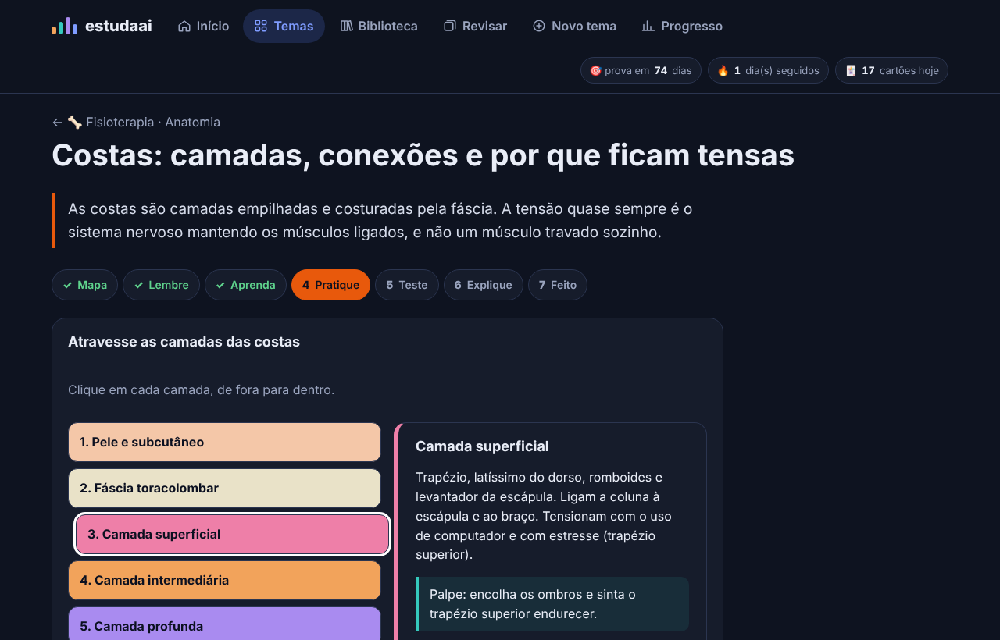
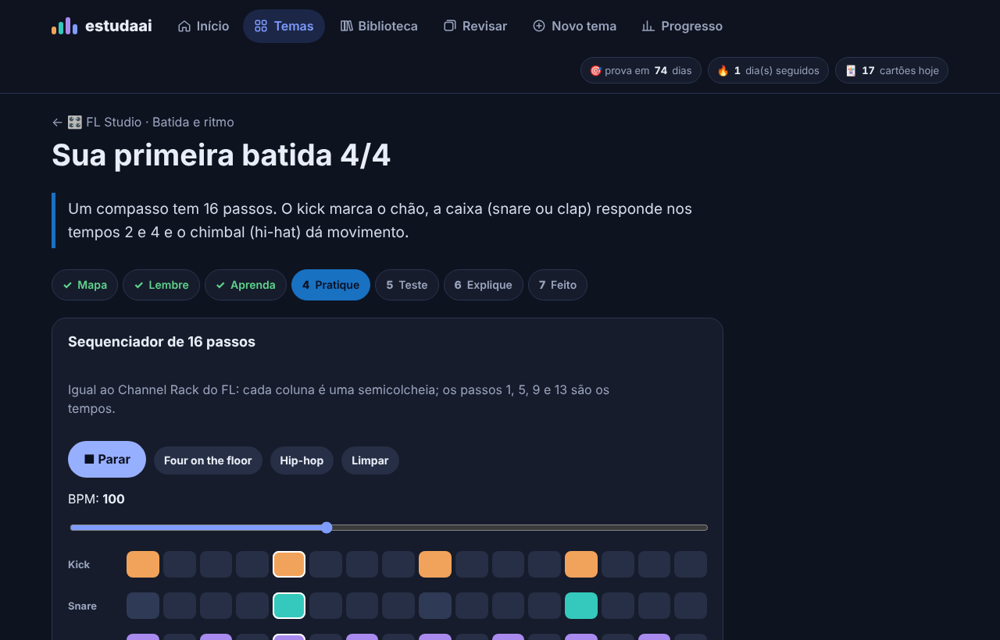

<div align="center">

# 🧠 estudaai

**Seu estudo organizado a partir dos seus PDFs, no seu computador.**

Você joga uma apostila, uma lei ou um capítulo de livro. O estudaai separa as seções, monta uma aula interativa para cada uma e cria cartões de revisão. Depois ele decide o seu próximo passo todos os dias.

   



</div>

## ✨ O que ele faz

| | |
|---|---|
| 📄 **PDF vira trilha** | Lê o sumário do PDF ou detecta os títulos ("1.2 Contração muscular", "CAPÍTULO 3"). Cada seção vira um tópico, com as páginas de origem. |
| 🧩 **Aula em 7 passos** | Mapa mental → lembrar antes → conteúdo → prática interativa → teste → explicar com suas palavras (Feynman) → registrar. |
| 🃏 **Cartões automáticos** | Definições ("X é…"), lacunas com os termos-chave e lacunas com números e prazos ("30 dias", "40 %"). Cada cartão aponta para a página do PDF. |
| 🔁 **Revisão espaçada de verdade** | Algoritmo **FSRS-4.5**, o mesmo modelo de memória que o Anki usa hoje. As aulas também voltam para revisão. |
| ✨ **IA opcional** | Na versão na nuvem, usa o Claude da sua conta. No PC, sem chave, monta o pedido com o texto do PDF para colar no Claude; com chave da API, gera a aula sozinho. |
| 🎯 **Próximo passo** | Toda manhã: cartões → aula principal → aula de "recompensa" de outro tema. Você não precisa decidir nada. |
| 🔎 **Busca** | Procura uma palavra em todos os seus PDFs e abre a aula daquele trecho. |
| 📤 **Anki** | Exporta os cartões em `.csv`, pronto para importar no Anki. |

Já vem com **7 temas** e **19 aulas** interativas: concurso UFMS (TI), fisioterapia, neurociência, FL Studio, teoria musical, violão e Libras. As práticas incluem piano com som, sequenciador de batida, acordes de violão, disparo de neurônio, curva do esquecimento e tabela-verdade.

<p align="center">
 
 
</p>

## ☁️ Versão na nuvem (PC, notebook e celular)

O mesmo app roda como uma página do Claude, sem instalar nada:
- **Progresso sincronizado:** fica salvo na sua conta e aparece igual em qualquer aparelho. Também há o botão **Progresso → Sincronizar agora**.
- **PDFs:** são lidos no próprio navegador (pdf.js) e guardados na sua conta.
- **IA:** usa o próprio Claude, sem chave de API.

O código é o mesmo `web/index.html`: ele detecta onde está rodando (nuvem, servidor local ou arquivo) e se adapta.

## 🚀 Como rodar

Você precisa só do **Python 3.10+** ([python.org](https://www.python.org/downloads/)).

**Windows:** dois cliques em **`ESTUDAAI.bat`**. Na primeira vez, ele instala o `pypdf` sozinho.

**Mac/Linux:**
```bash
./estudaai.sh
# ou, manualmente:
python -m pip install -r requirements.txt
python servidor.py
```

O navegador abre em **http://127.0.0.1:8765**. Vá em **Biblioteca** e arraste um PDF. Para testar, use `exemplos/apostila-exemplo.pdf`.

> Sem servidor também funciona: abra `web/index.html` direto no navegador. As aulas e os cartões prontos funcionam; só a importação de PDF precisa do servidor.

### IA (opcional)
Em **Biblioteca → IA**, cole uma chave da [API da Anthropic](https://console.anthropic.com/). Ela fica só em `dados/config.json`, no seu computador. Você também pode usar a variável `ANTHROPIC_API_KEY`.

## 🗂️ Onde ficam as coisas

```
estudaai/
├── ESTUDAAI.bat / estudaai.sh   ← abrir
├── servidor.py                  ← servidor local (só biblioteca padrão do Python)
├── nucleo/
│   ├── organizar.py             ← PDF → seções → termos, definições, lacunas, aula
│   └── ia.py                    ← aula com IA (opcional)
├── web/index.html               ← o app (gerado; não edite à mão)
├── fonte/                       ← código do app e aulas prontas → python fonte/build.py
├── conteudo/                    ← temas e cartões que já vêm prontos
├── dados/                       ← SEU material: PDFs, progresso, config (fora do git)
└── testes/
```

**Seus dados não vão para o GitHub:** a pasta `dados/` está no `.gitignore`. Para fazer backup, copie essa pasta ou use **Progresso → Copiar backup**.

## 🧪 Desenvolvimento

```bash
python testes/gerar_exemplo.py     # recria o PDF de exemplo (precisa de reportlab)
python -m unittest discover testes # testes do organizador de PDF
python fonte/build.py              # depois de editar fonte/ ou conteudo/
```

**Para criar um tema pronto**, adicione `conteudo/temas/<tema>.json` e a entrada em `META` no `fonte/build.py`. **Para criar uma aula**, adicione um `AULAS.<id> = {...}` em `fonte/aulas-*.js` (o formato está em `docs/REFERENCIAS.md`).

## 🙏 Referências e inspirações

O estudaai junta ideias de projetos abertos. Os detalhes estão em [docs/REFERENCIAS.md](docs/REFERENCIAS.md).
- [open-spaced-repetition / FSRS](https://github.com/open-spaced-repetition): o algoritmo de revisão.
- [lfnovo/open-notebook](https://github.com/lfnovo/open-notebook): fontes viram cadernos, roda local, IA opcional.
- [cardflash](https://github.com/cardflash/cardflash-angular): cada cartão aponta para o trecho do PDF de origem.
- [ankitects/anki](https://github.com/ankitects/anki): exportação compatível.
- Dunlosky et al. (2013): as técnicas de estudo com mais evidência (testar-se e espaçar).

## Licença
MIT © Vitória Costa
